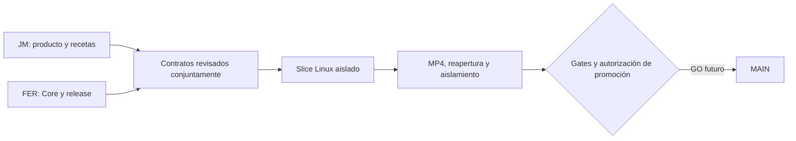

# CORE V2 — primer lote JM: producto, reutilización y aceptación

Fecha: 25-11-2026. Estado: propuesta para revisión, no contrato congelado.
Coordinación: [#415](https://github.com/Montara-Projects/Montara/issues/415).
Fuente inspeccionada: Montara `7113fd2801558cc31bf9b2c1bfab360c7faa40ca`.
Pines Git: Engine `9af275b18535005e36bd289a68ceb4a1d2f6c506`,
Mixer `f15ff91c1b80fc5f157099dcd9451d958d553ae6`.
Estos pines no certifican los procesos desplegados ni los Companions instalados.

## Alcance que puede empezar ahora

El propietario solicita comenzar las tareas asignadas. JM aporta requisitos,
inventario de producto/editor, recetas, fixtures y criterios de calidad; FER
lidera inicialmente Core/release/instalador. Este lote no implementa un Core
paralelo, no cambia contratos de producción ni selecciona infraestructura.
No se necesita esperar la elección de entorno para entregar estas entradas.

Últimos acuerdos leídos: candidato 7141340666, ACK FER 7150570278 y respuesta
JM 7151607436 en #415. Repositorio de V2, entorno, recursos, presupuesto y
autorización de implementación compartida siguen siendo decisiones separadas.

## Inventario focalizado: reutilizar, adaptar o sustituir

Las rutas son relativas al checkout fijado arriba. «Reutilizar» no equivale a
certificación V2. La licencia de redistribución y las dependencias transitivas
de cada pieza quedan por verificar antes de empaquetar/distribuir.

| Pieza JM | Evidencia de código / pruebas existentes | Decisión propuesta y límite | Revisión |
|---|---|---|---|
| UI Stage/Push/Show | `web/montara.js`, `web/full-session.js`, `tests/e2e_journey.py` | Adaptar puntos de API/capacidades, conservar editor; no copiar overlays sin reconciliar | JM; FER contratos |
| Receta de export nativo | `companion/video_recipe.py`, `tests/test_local_video.py` | Reutilizar validador data-only mediante adaptador versionado; actualmente exige `version=1`, `platform=youtube` | JM; ambos contrato |
| Ejecución local de vídeo | `companion/video_jobs.py`, `companion/local_video.py`, `tests/test_local_video.py` | Adaptar identidad/autorización/attempt alrededor del renderer; conservar Engine por API, sin reescribirlo | JM + FER |
| Mezcla local y sesiones | `companion/local_mix.py`, `full_session.py`, `mixer_adapter/session.py`, `tests/test_full_session.py`, `tests/test_local_mix.py` | Reutilizar algoritmos y aislamiento; adaptar representación/receta/artefacto, no importar globals de Mixer en hilos nuevos | JM + FER |
| Push/Reels | `reel_selection.py`, `push_pack.py`, `tests/test_reel_selection.py`, `tests/test_push_pack.py` | Reutilizar selección y captions; separar montaje de reel de publicación Push; música independiente no exige sync Stage | JM |
| Show | `show_editor_state.py`, `show_cut_edit.py`, `tests/test_show_cut_edit.py`, `tests/fixtures/show/manifest.json` | Inventariar y adaptar tras slice mínimo; no afirmar que el validador Stage acepta Show | JM |
| Identidad y proyectos | `urano/session_auth.py`, `urano/project_catalog.py`, `tests/test_google_owner_catalog_i2.py`, `tests/test_urano_project_catalog.py` | Reutilización candidata, ownership FER; JM aporta escenarios, no crea segundo catálogo/OAuth | FER; JM aceptación |
| Recuperación y aislamiento | `urano/job_recovery_ledger.py`, `urano/native_owner_project_scope.py`, `tests/test_native_owner_project_scope.py` | Reutilización candidata a revisar por FER; no equiparar lease existente con todo el contrato Task/Attempt V2 | FER; ambos QA |
| Almacenamiento/ingestión | `resumable_upload.py`, `source_cache.py`, `tests/test_session_proxies.py`, `tests/test_native_owner_storage_guard.py` | Adaptar localizaciones y permisos; mantener originales locales salvo consentimiento; no reemplazar por otro sistema sin comparación | Ambos |
| Release/instalador | `companion/macos-installer/build.sh`, `tests/test_companion_installer.py`, `tests/companion-native-installer.test.cjs` | Reutilización a evaluar por FER; paquete instalado e imports efectivos requieren pruebas, no solo build | FER; JM Mac |

No se ha identificado aquí una pieza que deba reescribirse por completo.
Ausencia de LICENSE general en el árbol consultado no concede derechos de
redistribución: aclarar licencias de repositorios, FFmpeg/codecs, modelos y
binarios antes de publicar un paquete nuevo. No modificar submódulos.

## Invariantes de producto para el contrato

1. Un proyecto puede tener varias canciones; cada canción conserva intervalo,
   máster, mezcla, cortes, encuadres/movimientos 360 y artefactos independientes.
2. La receta es un snapshot revisado. Guardar requiere revisión esperada;
   conflicto concurrente visible, sin sobrescritura silenciosa.
3. Fuentes se identifican por asset/revisión/representación; rutas locales o
   nombres visibles no son IDs de dominio. Proxy y original no son equivalentes.
4. Cámara: `inicio absoluto de canción + tiempo relativo − offset`. Ejemplo:
   canción 2 desde 91 s, offset 0, editor 0 → cámara 91 s. No recalcular sync
   al cambiar canción. Declarar unidad, base temporal y redondeo del perfil.
5. Stage conserva sincronización musical obligatoria en los modos que la
   requieren. Un reel puede usar vídeo y música independientes sin invocar esa
   condición; un fallo no cambia de producto o de calidad automáticamente.
6. UI distingue capacidad, detección, vinculación y autorización del trabajo.
   Un origen HTTPS compartido o `/health` no autoriza a ejecutar ni descargar.
7. Job/Task/Attempt y publicación deben vincularse al snapshot y executor exactos.
   Retry no duplica output/cuota; un attempt obsoleto no publica tras cancelación.
8. Originales desktop permanecen locales. Transferencia original cloud exige
   elección explícita, cuota, checksum y retención informada. Cloud desactivado
   no impide el recorrido local-first.
9. Reabrir recupera medios y edición persistidos; vista inicial y navegación
   son UX, no sustitutos del estado guardado. Rename no cambia identidad.
10. Captions manuales no se pierden por ASR vacío/parcial. Preview y MP4 deben
    compartir tiempos, geometría y estilo; calidad ASR se evalúa aparte.
11. Export máximo usa originales verificados. Si falta una fuente, identificar
    el medio y pedir asociación; nunca presentar upscale de proxy como original.
12. Export local confinado a carpeta autorizada/Exports, nombre sin sobrescritura,
    publicación atómica y resultado disponible aunque falle la UI posterior.

Estos requisitos no introducen ahora un schema V2 nuevo. FER/JM deben acordar
el mapeo a los contratos antes de cambiar productores o consumidores.

## Matriz de fixtures y aceptación propuesta

Solo medios sintéticos generados o fixtures con procedencia/licencia autorizada.
Los nombres siguientes son identificadores de escenarios, no archivos existentes.
No copiar medios personales de V1 al entorno V2.

| ID / responsable | Fixture y acción | Evidencia y condición GO | Estado actual |
|---|---|---|---|
| JM-S01 / JM + FER | Slice mínimo: dos owners de prueba, un proyecto, vídeo sintético corto, receta Stage y máster sintético | Linux real: login→proyecto→media→receta→job→Engine→MP4→reapertura; ffprobe y decode completo; logs por ID opaco, fuentes/pines y hashes | Pendiente V2 |
| JM-S02 / JM | Actuación 182 s, 2 cámaras, 2 WAV, canciones 0–91 y 91–182 | Dos ediciones/másteres/exports persistentes; frames canción 2 corresponden a segundo 91; originales no duplicados | Propuesta posterior a S01 |
| JM-S03 / JM | Equirectangular con marcadores, 3 keyframes por canción, cambio manual de cámara | Inicio/intermedio/final muestran movimiento esperado; independencia 1→2→1→2 y reopen; tolerancias por perfil acordadas antes de PASS | Propuesta posterior a S01 |
| JM-S04 / JM | Reel con vídeo e imagen + canción distinta | Sin exigir match musical; cortes/captions persisten en MP4; Stage conserva su sync | Propuesta |
| JM-S05 / ambos | Owner A/B, sesión revocada, dispositivo ajeno, cloud desactivado | Lectura/escritura/medios/jobs/exports cruzados rechazados; cero bytes originales transferidos sin consentimiento | Pendiente V2 |
| JM-S06 / FER + JM | Respuesta perdida, retry, cancelación, reconexión y reinicio aislado | Un output/reserva; attempt antiguo no publica; nuevas escrituras sobreviven recuperación/rollback | Pendiente V2 |
| JM-S07 / JM Mac, FER Windows | Instalar paquete fijado en target real, vincular y exportar | Imports desde paquete, salud con versión efectiva, permisos locales, autorización y Exports; estabilidad de Companion existente | Pendiente V2/hardware |
| JM-S08 / JM | Caption manual y automático insuficiente; logo; cambio de idioma | Manuales conservados, error ASR honesto, preview/export equivalente, logo no bloquea navegación, sin traducir nombres de medios | Propuesta |

S01 es el mínimo; multicanción, 360, Show completo y móvil no son requisitos
ocultos de la primera demo. Son compatibilidad que debe preservarse y probarse
antes de una promoción que afecte esos recorridos.

## Entregas pequeñas y dependencias

1. Este PR: inventario JM, invariantes y matriz. Revisión FER sobre fronteras y
   suficiencia del slice; sin runtime. Esfuerzo bajo relativo a implementación.
2. JM: fixture reproducible y baseline de receta sobre componentes fijados,
   coordinada con contrato v0 de FER. No crear segundo scheduler ni catálogo.
3. FER: entorno/instalador/contratos y slice Linux. Requiere decisiones de
   repositorio, aislamiento y capacidad; JM revisa API y valida calidad.
4. JM: adaptador editor/Companion y QA diferencial Mac sobre artefacto exacto.
   Esfuerzo medio-alto, condicionado a contratos y disponibilidad del paquete.
5. Ambos: gates de promoción y rollback compatible con nuevas escrituras;
   implementación MAIN o migración solo con autorización correspondiente.

La fecha orientativa del 24/12 no constituye compromiso de paridad. No se
aprovisionan servicios, no se activa cloud ni se promete ahorro de rendimiento.

## Verificación de esta entrega

Inspección de Git/código y comprobación de rutas: no inspección de VM.
Fixture disponible: `tests/fixtures/core-v2/stage-recipe-v1.json`, con instrucciones
en su README. Roundtrip idempotente PASS: seis segundos, dos fuentes y tres cortes.

En Mac, Python 3.12, entorno temporal separado con pytest 9.2.0 y NumPy 2.5.5:
`python -m pytest tests/test_local_video.py -k 'recipe or neutral_interval' -q`
→ **22 passed, 3 deselected**. Los tres renders no se ejecutaron; submódulos
no inicializados. Las 34 rutas del inventario existen en el checkout.
No se acredita aquí
E2E Linux, instalación Mac, OAuth real, benchmark o funcionamiento de V2.
Rollback documental: revertir este commit; datos y servicios no cambian.
